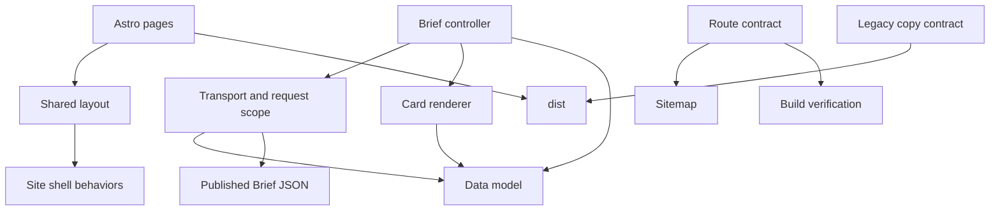

# Website architecture

J.H. LAB remains an Astro static site. `npm run build` produces the only deployable directory, `dist/`.

## Responsibilities

| Layer | Location | Responsibility |
| --- | --- | --- |
| Route templates | `src/pages/` | Page structure, scoped styles, and page-specific script entry points |
| Shared layout | `src/layouts/BaseLayout.astro` | Document metadata, initial theme, navigation, footer, and shared bootstrapping |
| Shared behavior | `src/lib/site-shell.ts`, `src/lib/site/` | Theme/language, menu, clipboard, and pointer lighting; no Brief data access |
| Brief controller | `src/lib/brief-reader.ts` | Selected scope and filters, loading/error states, pagination, publisher refresh |
| Brief model | `src/lib/brief/model.ts` | JSON boundary, types, search, dates, and ordered deduplication; no DOM or fetch |
| Brief transport | `src/lib/brief/api.ts` | Fetch, HTTP errors, cancellation, and bounded archive scheduling; no DOM |
| Brief cards | `src/lib/brief/cards.ts` | Safe DOM construction, research citations, and reading expansion; no fetch |
| Site content | `src/data/site.ts` | Navigation, project metadata, and contacts |
| Route contract | `src/data/routes.json` | Public paths, built HTML locations, and sitemap eligibility |
| Build contract | `scripts/site-contract.mjs` | Legacy-copy allowlist and required deployment artifacts |



## Brief loading contract

- Single-date, recent-range and full-archive views use the same JSON parser and transport.
- Archive requests run with at most four active fetches. Results keep input date order; duplicate source URLs keep the newest issue's item.
- Switching scope aborts the old request group and prevents queued work from starting. Only the current request may update the UI.
- Every load revalidates its JSON (`cache: no-cache`). An evening publication can update an existing date without a page reload.
- A failed subset retains available stories and reports missing issues. Total failure exposes retry. A publisher refresh retains an archive search instead of reverting it to one date.
- Optional malformed research is omitted while its ordinary news summary remains readable. Required issue/story fields still fail validation.
- Loading clears the old pagination selection, so the intersection observer cannot append stale cards over skeletons.

## Ownership of generated output

Astro owns route HTML, including `dist/brief/index.html`, and copies `public/`. The bridge copies only `assets/`, `images/`, `experiments/`, and `brief/data/`. It validates all four directories before copying, and never copies the old `brief/index.html`.

The external news publisher continues writing its existing JSON to `brief/data/`; this change does not alter that schema or publishing workflow. New Astro routes should be registered in `src/data/routes.json` so artifact checks and sitemap generation share the same inventory. Navigation labels and project links remain in `src/data/site.ts`.

## Verification and release

```powershell
npm ci
npm run validate
npm run test:e2e
```

`validate` runs Astro diagnostics, Node build-contract tests, TypeScript data/request tests, a production build, and output verification. Domain tests need no browser or preview server. Browser tests cover the actual built site on desktop and simulated mobile. Install the project's Playwright Chromium before browser testing.

Feature branches stay in a PR and use preview configurations. Keep the production branch guard and publish only verified `dist/` output. A local pass or Wrangler dry run is not evidence of a production deployment.
